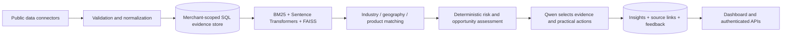

# FLOW / BijakSense

BijakSense is the market-intelligence section of the existing merchant companion. It adds five evidence modules, a private signal store, merchant matching, deterministic calculations, constrained Qwen recommendations and a dashboard. Existing Telegram capture, ElevenLabs transcription, bookkeeping and financial screens are reused without being rebuilt. Nothing has been uploaded or deployed.

## Run locally

From the project directory:

```powershell
.venv\Scripts\python.exe -m pip install -r requirements.lock.txt
.venv\Scripts\python.exe -m scripts.setup_bijaksense
.venv\Scripts\python.exe -m scripts.migrate
./Start-KedaiFlow.ps1 -NoBrowser
```

If the project is already running, first run `./Stop-KedaiFlow.ps1`. The launcher now starts a separate BijakSense worker alongside the existing API, capture worker and frontend. It records all four process identities for safe shutdown. The embedding download is needed once per machine; CPU inference works without a GPU or embedding API key.

Open **http://localhost:3000 → BijakSense**. A real merchant first saves their industry, operating location/coordinates, products, materials, supply markets and chosen commodity benchmarks. Existing confirmed-deal products are suggested. Merchant identity and permissions come from the existing session. Add competitor public URLs, then **Refresh intelligence**. The dashboard polls while background work completes.

For a clearly labelled example only, `python -m scripts.seed_bijaksense_demo` creates a sample Kuala Lumpur grocery context and public watchlist in the existing synthetic demo business. It refuses to overwrite an existing context or touch a non-fixture business. This is an example competitor relationship, not a claim about the user's competitors. External evidence is real; merchant profile and financial records are synthetic.

## APIs and keys to keep it running

Keep secrets in **`.env`**, never `.env.example`, browser code or Git.

| Service | Needed | Configuration / purpose |
|---|---|---|
| Groq, serving Qwen | Yes for Qwen recommendations; your existing Groq key works | `GROQ_API_KEY` is reused. Optional separate `BIJAKSENSE_QWEN_API_KEY`. Tested model: `BIJAKSENSE_QWEN_MODEL=qwen/qwen3.8-27b`. `MODEL_PROCESSING_APPROVED=true` enables model processing. |
| Open-Meteo | Public evaluation endpoint needs no key; commercial use needs their commercial plan | Set `BIJAKSENSE_OPEN_METEO_API_KEY` for the implemented customer endpoint. [Commercial licensing](https://open-meteo.com/en/pricing), [forecast API](https://open-meteo.com/en/docs). No subscription was purchased. |
| World Bank Pink Sheet | No API key | Downloads official monthly commodity history. `BIJAKSENSE_WORLD_BANK_URL` can replace a changed publication URL. [Official commodity data](https://www.worldbank.org/en/research/commodity-markets). |
| DOSM / data.gov.my | No API key for the implemented public dataset download | Malaysian wholesale/retail sales value and volume history, attributed under CC BY 4.0. [Dataset](https://open.dosm.gov.my/data-catalogue/iowrt). |
| Public news RSS | No key for the implemented headline discovery feed | Default Google News RSS discovery, with publisher headline and linked source. `BIJAKSENSE_NEWS_RSS_URL` accepts an alternative authorized public HTTPS RSS feed. No premium news service or full article scraper is claimed. |
| Competitor public sources | No general API key | Merchant supplies the canonical HTTPS webpage or RSS URL and confirms permission. The connector respects robots.txt, access controls and limits; unavailable/private sources remain unavailable. |
| Sentence Transformers + FAISS | No API key | Multilingual embedding model downloads from Hugging Face once, then runs locally. No merchant text is sent to an embedding service. |

No new ElevenLabs or Telegram key is needed **for BijakSense**. Existing capture integrations keep their own settings. Optional paid daily/local commodity data is not integrated: the current charts are **monthly international benchmarks**, not real-time Malaysian spot prices. Obtain a provider with appropriate redistribution terms only if daily/local prices are required; adding its key alone will not create an adapter.

## Implemented data flow



The existing SQLAlchemy database is reused: SQLite for the validated local app, PostgreSQL supported by the additive `database/migrations/0003_bijaksense.sql`. Normal tables hold commodity observations, invoice totals, currencies, units, dates and feedback. Vectors never calculate financial or price changes. Embeddings and their model identity persist with text signals; a tenant-specific FAISS index is rebuilt from those stored vectors during analysis. BM25 and cosine results combine through reciprocal rank fusion after relevance/freshness filtering. Missing model files cause an explicitly reported BM25-only mode, not a false claim of vector retrieval.

The nine required models are implemented in `services/api/bijaksense/models.py`: MerchantContext, MarketSignal, SignalSource, CommodityPriceObservation, CompetitorProfile, CompetitorObservation, MarketInsight, RecommendedAction and IngestionJob. Composite tenant foreign keys protect source/signal and competitor/observation relationships. Every saved insight includes merchant ID and evidence IDs. Signal publication time is nullable and explicitly marked unknown when a provider does not establish it; retrieval time is never substituted as publication time. Source reliability, geography, freshness deadlines and observation times are retained.

PostgreSQL migration enables RLS on FLOW tables and revokes direct access for Supabase `anon`/`authenticated` roles when present. The server database owner accesses them through tenant-authorized APIs. PostgreSQL/Docker execution was not live-tested in this environment; SQLite persistence and isolation were tested.

## Module behavior and limits

- **Supply chain:** retrieves public news headlines about supply, logistics, shortages, ports and trade restrictions. Publisher reports remain qualitative and unverified. Country mentions come from headlines, not the search filter. Product/material terms and explicit logistics exposure determine matching. Related reports are retained for comparison; the system never infers consensus or silently resolves contradictions.
- **Commodity prices:** parses the World Bank workbook's actual header/unit rows, normalizes USD/tonne to USD/kg, preserves original values, and stores up to 25 monthly observations per selected benchmark. Calculates exact available 1-, 3- and 12-month changes with Decimal arithmetic. Currency/unit/location mismatches are excluded and counted. No interpolation, missing-value zeros or undocumented MYR conversion. Profile cost-category mappings explain where a benchmark could matter. Outdated workbooks remain stale even after a new download.
- **Weather:** retrieves seven daily forecasts at the merchant's coordinates, validates units, and marks rain (at least 20 mm or 80% probability), heat (at least 35°C) and wind (at least 40 km/h) as conditional operational risks. These are transparent application thresholds, not official weather warnings. Forecasts expire after 12 hours; later snapshots supersede earlier ones. No flood, delivery failure or closure is asserted from a forecast.
- **Consumer trends:** uses DOSM wholesale/retail aggregate sales and volume changes for matching industries, including year-on-year comparisons. Other industries receive explicitly qualitative public industry news. Independently, existing issued, undisputed receivable invoices support two completed 28-day sales-value windows when both contain data. Currency and sample-data labels are retained. Invoiced value is never called cash receipts, unit demand or proof of increased product interest. There is no guaranteed product-demand or causal seasonal forecast.
- **Competitors:** reads merchant-selected public RSS announcements or one robots-permitted webpage. Stores observation time, source link, content hash and excerpt. JSON-LD Offer prices retain currency/product description and are explicitly advertised, not checkout verified. Launch/promotion keyword mentions are labelled as mentions, not newly confirmed events. Repeated identical content is deduplicated. First observations do not establish a new launch or a price change; sign-in, redirects, blocked robots rules and JavaScript-only content are not bypassed.

The current financial model has no complete stock-on-hand/BOM coverage. Recommendations describe conditional exposure by product/material and recorded cost category; they do **not** invent affected stock quantities, margin losses or purchase quantities.

## Recommendation safeguards

Qwen receives a bounded set of relevant candidate facts, the merchant's selected product/material context and scoped recorded-outflow aggregates. Raw Telegram messages, customer names, credentials and original documents are not included. Numerical history is calculated locally and omitted from the selection prompt when unnecessary.

Pydantic validates Qwen's returned candidate IDs and action codes; IDs must exist in that merchant's evidence packet and actions must belong to the candidate's allowed list. Extra fields, invented prices, invented sources, unauthorized actions, tool calls, refusals, truncation and missing categories trigger labelled deterministic fallback. Free-form model claims are never rendered. Merchant-facing explanations are composed from validated evidence and calculations. Recommendations never execute purchasing, payments or outbound messages.

## API

All requested paths are implemented on FastAPI and proxied unchanged by Next.js:

```text
GET  /api/bijaksense/overview
GET  /api/bijaksense/signals?category=weather&limit=50&offset=0
GET  /api/bijaksense/signals/{signal_id}
GET  /api/bijaksense/commodities
GET  /api/bijaksense/weather
GET  /api/bijaksense/trends
GET  /api/bijaksense/competitors
POST /api/bijaksense/analyze
GET  /api/bijaksense/insights
POST /api/bijaksense/insights/{insight_id}/feedback
POST /api/bijaksense/refresh
```

Support endpoints: GET/POST `/context`, POST `/competitors`, POST `/competitors/{id}/disable`, GET `/jobs/{id}` under the same prefix. See http://localhost:8000/docs for validated request schemas. Signal lists default to current relevant evidence; `relevant_only=false` includes stored history. Individual evidence IDs remain inspectable within their merchant. Feedback statuses: `acknowledged`, `dismissed`, `useful`, `not_relevant`, `new`; optional note up to 1,000 characters. Dismissals persist across repeat analysis.

Owner/bookkeeper/accountant can read financial-context intelligence. Owner alone manages profiles, sources, refresh and analysis. Sales-only membership cannot read this financial-context feature. All IDs are scoped to the current merchant, including detail, job and feedback endpoints; caller-supplied merchant IDs cannot override membership.

Refresh and analysis share a **database-backed 15-minute merchant limit**. An active job is reused; another completed request in that window returns 429. At most ten source profiles per merchant, bounded download sizes, public-IP DNS pinning, TLS validation, timeouts, no credential-bearing URLs and no redirects protect source fetching. XML external entities are disabled. The existing origin boundary also applies.

## Background operation

```powershell
.venv\Scripts\python.exe -m services.api.bijaksense.jobs
```

Enabled contexts are refreshed every six hours by default (`BIJAKSENSE_REFRESH_HOURS`, minimum one hour); scheduler checks once a minute. `BIJAKSENSE_SCHEDULE_ENABLED=false` disables automatic enqueueing while manual queued jobs still run. Each category commits separately so a blocked provider does not erase successful evidence. In-flight jobs older than 20 minutes are marked failed with partial data preserved; paid model calls are not automatically retried after an uncertain worker interruption. Keep the worker and API running for scheduled updates.

## Verification

```powershell
.venv\Scripts\python.exe -m pytest -q
.venv\Scripts\python.exe -m scripts.check_bijaksense --live
npm.cmd --prefix apps/companion run build
```

The live evaluation is opt-in and uses isolated synthetic grocery and construction profiles in private `.local/flow-evaluation/`. It fetches real public evidence, runs multilingual FAISS retrieval and makes one Qwen request per profile. It does not read the actual merchant ledger or assert that the demonstration public sources are the user's competitors. Private reports are excluded from source archives. Provider responses can change: unavailable sources remain unavailable rather than being replaced with samples.

On 16 October 2026 (Malaysia time), both live evaluations returned all five evidence categories and validated Qwen selection using `qwen/qwen3.8-27b`. The initial oversized Qwen request returned 413; the bounded evidence packet was implemented and successfully retested. Tested competitor sources: 99 Speedmart's public press releases and MR D.I.Y.'s public promotion page. The current workbook reported September 2026 monthly prices. Tests also cover irrelevant industries/geographies, stale sources, missing providers, conflicting headlines, unit/currency mismatches, blocked competitors, source injection/LLM rejection, merchant isolation, deduplication, interrupted jobs and measured sales coverage.
